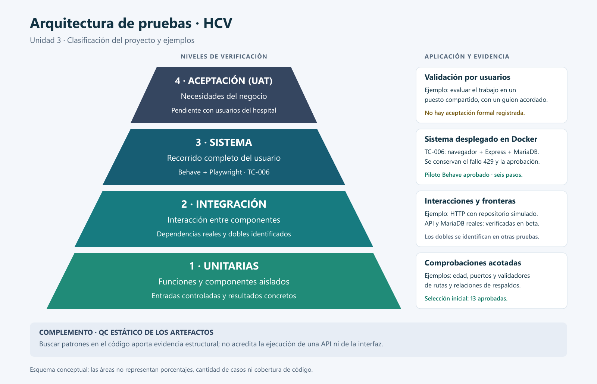

# Unidad 3 — Clasificación y arquitectura de pruebas de HCV

Fecha: 16 de noviembre de 2026. Estado: clasificación del código existente y diseño del siguiente ciclo; resultados ejecutados identificados por separado.

## 1. Propósito y fuentes

Organizar el control de calidad de HCV según **Unit Testing, Integration Testing, System Testing y User Acceptance Testing (UAT)** de la Unidad 3, apartados 3.1–3.4. La clasificación considera el objetivo de la comprobación, los componentes reales y las dependencias sustituidas; el lenguaje, el nombre del archivo o el framework no determinan por sí solos el nivel.

La bibliografía utilizada es `unidad3 (2).html`, proporcionada por el usuario. Se aplican sus apartados 2.1–2.4 al alcance, criterios, entorno y datos, y 5.1–5.3 a los riesgos. La estructura se adapta al trabajo académico y no acredita conformidad con ISO/IEC/IEEE 29119-3 ni certificación institucional.

Se mantienen Node.js, Express, MariaDB y el frontend actual. Las pruebas existentes se conservan en sus rutas para preservar imports y comandos. La organización es lógica y queda consultable en el [inventario estructurado](inventario-niveles-pruebas-hcv.json); no se movieron ni reescribieron todas las pruebas para construir una pirámide visual.

## 2. Pirámide y niveles



[Versión vectorial para incorporar al informe o a diapositivas](figuras/piramide-pruebas-hcv.svg).

La anchura de los niveles expresa una orientación de diseño: muchas comprobaciones acotadas y una selección de recorridos completos. **No representa una distribución medida, una proporción obligatoria ni cobertura de código.** UAT se muestra como culminación de la validación del negocio; no se convierte en una cuota de tests automatizados.

| Nivel de la Unidad 3 | Objeto y límite | Aplicación concreta en HCV | Evidencia y estado |
| --- | --- | --- | --- |
| 3.1 Unit Testing | Función o componente lógico con fronteras externas controladas. | Edad con fecha fija; configuración de puertos; validadores de rutas y relaciones de respaldos. | Trece comprobaciones seleccionadas ejecutadas y aprobadas el 16/11/2026. No acredita todas las unitarias del repositorio. |
| 3.2 Integration Testing | Interacción entre componentes y dependencias. Se distingue qué es real y qué está sustituido. | HTTP de login con repositorios sustituidos; documentos con filesystem temporal; pruebas optativas de Express/MariaDB. | Cuatro comprobaciones mixtas de autenticación aprobadas. Las dos integraciones optativas MariaDB se inspeccionaron, sin habilitarlas en esta revisión. |
| 3.3 System Testing | Comportamiento del sistema desplegado observado mediante un recorrido completo. | TC-015 con navegador, frontend, Express y MariaDB reales en Docker beta. | Fallo reproducido en la imagen anterior y aprobación de seis pasos después de actualizar la API. Un escenario, no seis TC. |
| 3.4 UAT | Usuarios representativos evalúan si el producto satisface sus necesidades. | Validar el uso de un puesto compartido en condiciones acordadas con el hospital. | Pendiente. No hay participantes, sesión ni aceptación hospitalaria registrados. |

### Comprobaciones complementarias

Varios tests ejecutados con Node leen fuentes y buscan patrones mediante expresiones regulares. Para este trabajo se clasifican como **QC estático de artefactos**, separado de los niveles dinámicos. Por ejemplo, encontrar una ruta en el código no demuestra que su endpoint haya respondido correctamente.

Del mismo modo, una prueba que utiliza un navegador con toda la API interceptada verifica la integración de la UI con el navegador, pero no el sistema completo con Express y MariaDB.

## 3. Inventario de la suite actual

Se inspeccionaron **21 archivos de pruebas Node, una prueba Python de UI con respuestas sintéticas y un archivo Gherkin con TC-015**: 23 artefactos de verificación. Esto no es un recuento de casos: hay archivos mixtos y subpruebas. El archivo de fixture y los dos archivos de implementación/preparación de Behave son soporte y se identifican aparte.

| Archivo existente | Clasificación | Fundamento y límite |
| --- | --- | --- |
| [test/age.test.js](../test/age.test.js) | Unitaria / componente | Función age aislada en una VM, con fecha controlada. La lectura del archivo prepara la función; no es una consulta clínica ni una prueba de navegador. |
| [test/auth.test.js](../test/auth.test.js) | Unitaria / componente + Integración parcial | Archivo mixto: los dos primeros casos recorren HTTP, rutas, controlador y servicio con repositorios sustituidos; los dos últimos llaman directamente al servicio con dobles. |
| [test/backup-recovery.test.js](../test/backup-recovery.test.js) | Integración parcial | Servicio de recuperación y filesystem temporal reales, repositorio y conexión sustituidos. No demuestra COMMIT o rollback en un motor MariaDB. |
| [test/backup-restore-validation.test.js](../test/backup-restore-validation.test.js) | Unitaria / componente | Validadores de rutas, identidades y relaciones sobre objetos sintéticos, sin HTTP, filesystem de documentos ni SQL. |
| [test/backups-frontend.test.js](../test/backups-frontend.test.js) | Unitaria / componente | Pruebas del componente JavaScript en VM, con DOM, carpetas y API sustituidos. Unidad lógica: módulo de respaldos; no es E2E. |
| [test/document-http-integration.test.js](../test/document-http-integration.test.js) | Integración parcial | HTTP, middleware, servicios y archivos temporales reales; MemoryMariaDb es un fake en memoria que no ejecuta SQL real. |
| [test/document-operations.test.js](../test/document-operations.test.js) | Unitaria / componente + Integración parcial | Principalmente journal y filesystem temporal con un fake de persistencia. Incluye guardas de componente que se detienen antes de modificar archivos. |
| [test/document-route-contract.test.js](../test/document-route-contract.test.js) | QC estático | Lee fuentes y aplica expresiones regulares. No ejecuta rutas ni verifica el contrato de un servidor desplegado. |
| [test/document-storage.test.js](../test/document-storage.test.js) | Unitaria / componente + Integración parcial | Los dos primeros casos validan configuración y claves; los restantes usan streams y archivos temporales reales. El enlace simbólico puede omitirse por permisos del equipo. |
| [test/documents-frontend.test.js](../test/documents-frontend.test.js) | QC estático | Comprueba patrones en el texto del frontend, sin ejecutar el DOM ni abrir un navegador. |
| [test/environment.test.js](../test/environment.test.js) | Unitaria / componente | Componente de configuración: puertos, host y rechazo temprano de root sin crear un pool ni abrir conexiones. |
| [test/mariadb.integration.test.js](../test/mariadb.integration.test.js) | Integración con SQL real | HTTP, servicios, repositorios, MariaDB y archivos temporales. Optativa; exige confirmar explícitamente la instancia y revierte datos sintéticos. Su existencia no prueba ejecución en Docker. |
| [test/patient-storage-rename-http.test.js](../test/patient-storage-rename-http.test.js) | Integración parcial | HTTP y componentes backend con pool sustituido; no modifica pacientes ni documentos del entorno beta. |
| [test/patients-frontend.test.js](../test/patients-frontend.test.js) | QC estático | Lee HTML/JavaScript y busca patrones. No verifica interacción de formularios mediante navegador. |
| [test/security.test.js](../test/security.test.js) | Unitaria / componente + Integración parcial | Caso de contraseñas: componente de hash y verificación. Caso RBAC: middleware y repositorio reales, con respuestas SQL sustituidas. |
| [test/server-startup-storage.test.js](../test/server-startup-storage.test.js) | Integración parcial | Arranque de la aplicación y recuperación con filesystem temporal; pool sintético. No es la instalación completa del hospital. |
| [test/storage-readiness-http.test.js](../test/storage-readiness-http.test.js) | Integración parcial | HTTP, routers y estado de almacenamiento, sin MariaDB ni un repositorio documental productivo. |
| [test/studies.test.js](../test/studies.test.js) | Unitaria / componente + QC estático | Dos casos de texto y un caso mixto: inspección de fuentes más ejecución de serializeStudy con objetos BIGINT sintéticos. |
| [test/study-date-http.test.js](../test/study-date-http.test.js) | Integración parcial | Ruta HTTP real y componentes backend con persistencia sustituida. |
| [test/users-mariadb.integration.test.js](../test/users-mariadb.integration.test.js) | Integración con SQL real | HTTP y SQL reales con transacción exterior y datos sintéticos; optativa y condicionada a autorización/configuración. Incluye inyección controlada de un error para comprobar rollback. |
| [test/users.test.js](../test/users.test.js) | Unitaria / componente + Integración parcial | Casos de servicio/repositorio con fronteras sustituidas y un último caso HTTP con servicios sustituidos. Contiene subpruebas; un archivo no equivale a un caso. |
| [test/browser/users-ui.py](../test/browser/users-ui.py) | Integración parcial | Chromium real con archivos del frontend y respuestas API interceptadas. Integra la UI y el navegador, pero no Express/MariaDB desplegados. |
| [features/autenticacion.feature](../features/autenticacion.feature) | Sistema | TC-015 recorre el navegador, frontend, Express y MariaDB reales del Docker beta. Se clasifica por el objetivo de sistema, no se vuelve a contar en los niveles inferiores. |

Soporte: [environment.py](../features/environment.py) prepara y cierra recursos; [steps/autenticacion.py](../features/steps/autenticacion.py) implementa el escenario; [docx-fixture.js](../test/helpers/docx-fixture.js) fabrica documentos sintéticos. No deben contarse como casos independientes. La carga de un helper por un runner tampoco demuestra un requisito del producto.

**Ampliación posterior del mismo día:** se incorporaron un ejecutor local y un generador HTML en `scripts/qc/`, con doce comprobaciones propias en Python. Verifican las herramientas de evidencia y se registran aparte en el inventario; no se agregan como unitarias del backend ni como doce TC nuevos de HCV. Su aplicación y verificación están en [las unidades 1 y 2](qc-unidades-1-2-aplicacion.md#10-unidad-2-mantenimiento-de-la-documentación-viva).

La clasificación de un archivo mixto se aplica por caso: no se suman todos sus resultados como unitarios ni se cuenta un mismo escenario en varios niveles para inflar la cobertura.

## 4. Ejemplos para explicar cada nivel

### 4.1 Unitaria: edad con fecha controlada

**Pregunta:** si la fecha actual es el día del cumpleaños, ¿la función devuelve los años cumplidos?

En [age.test.js](../test/age.test.js) se extrae la función real `age` del frontend y se ejecuta en una VM con `Date` controlado. Un ejemplo utiliza nacimiento `2000-04-15`, fecha actual `2026-04-15` y espera `26 años`.

No hay login, navegador ni consulta a pacientes. Se comprueba una función real de HCV; no se escribe una copia equivalente en Python. La lectura del archivo es preparación de la función y no convierte esta comprobación de edad en una integración documental.

**Límite:** se verifica el comportamiento programado de edad. No se acredita una regla clínica institucional ni toda la ficha del paciente.

### 4.2 Unitaria: validación de un respaldo

[backup-restore-validation.test.js](../test/backup-restore-validation.test.js) llama a validadores reales con objetos en memoria. Una ruta relativa aceptable se acepta y `../documentos/informe.pdf` se rechaza. También se rechaza una relación que apunta a un paciente ausente del conjunto sintético.

**Qué comprueba:** el validador decide correctamente ante esa entrada. **Qué requiere otro nivel:** que el respaldo se lea realmente del disco, que la API lo procese y que una restauración persista coherentemente.

### 4.3 Integración parcial: login por HTTP

Los dos primeros casos de [auth.test.js](../test/auth.test.js) envían solicitudes HTTP a Express en un puerto local temporal y recorren rutas, controlador y servicio. Los repositorios se sustituyen y no se abre MariaDB.

Se comprueba, entre otras cosas, que doce solicitudes de contraseña incorrecta reciben `401` y que solicitudes válidas posteriores reciben `200`.

Los otros dos casos del mismo archivo llaman directamente al servicio: validación de formato y reversión ante un fallo de auditoría representado por dobles. Por eso **el archivo completo es mixto**.

**Límite:** las transacciones y filas representadas por los dobles no acreditan restricciones ni rollback reales del motor SQL. Tampoco demuestran qué versión está desplegada en Docker.

### 4.4 Integración con MariaDB: ejemplo implementado y optativo

[users-mariadb.integration.test.js](../test/users-mariadb.integration.test.js) combina HTTP y SQL reales: comprueba unicidad, revocación de sesiones y rollback dentro de una transacción exterior con datos sintéticos. Exige habilitación y confirmación de base, puerto, cuenta y directorio de la instancia de pruebas.

**Estado en esta actividad:** inspeccionado, no ejecutado. No se habilitó por clasificarlo ni por disponer de Docker. Su configuración actual tampoco se considera automáticamente compatible con el Compose beta, cuya base no publica un puerto en Windows.

### 4.5 Sistema: TC-015, el ejemplo principal del trabajo

Cadena de trazabilidad: **RN-001 → RF-1.1 → HU-01 → TC-015**.

El escenario confirma que A y M ingresan, cierra sus sesiones, provoca doce fallos de M y luego intenta ingresar inmediatamente con A. Verifica la sesión devuelta por `/api/auth/me`, la identidad visible y la ausencia de espera impuesta.

| Versión y evidencia | Observación | Conclusión acotada |
| --- | --- | --- |
| [Imagen anterior: TC-015-20261116-150951](../reports/qc/TC-015-20261116-150951.json) | Los intentos incorrectos terminaron en `429`; A fue rechazada con `Retry-After: 899`. | El defecto de bloqueo compartido se reprodujo en esa imagen. |
| [Imagen actualizada: TC-015-20261116-151206](../reports/qc/TC-015-20261116-151206.json) | Doce respuestas `401`, ingreso de A con `200` y seis pasos aprobados. | TC-015 aprobó en el Docker beta actualizado. |

Las dos imágenes exactas y la intervención están registradas en [QC del login](qc-login-sin-bloqueo.md#tc-015-con-behave-y-playwright-16112026). No se cambió la expectativa para obtener la aprobación ni se borraron los contadores para eludir el defecto.

**Valor para la exposición:** los tests del código de trabajo podían aprobar mientras el Docker seguía ejecutando otra versión. La prueba de sistema aportó evidencia del comportamiento desplegado. Cada nivel responde una pregunta distinta.

Los errores previos de selectores y esperas pertenecían a la automatización. El bloqueo HTTP `429` pertenecía al sistema evaluado. Conservar la distinción evita presentar un problema del guion como defecto funcional del hospital.

### 4.6 UAT: guion previsto, sin ejecución atribuida

Un usuario representativo del hospital revisará, en una sesión acordada y con datos de prueba, si puede continuar trabajando en un puesto compartido después de errores de otra persona. Se registrarán participante/rol, versión, escenario, observaciones, resultado de negocio y decisión de aceptación o reservas.

La ejecución de un desarrollador, del estudiante o de Behave no se transforma por sí sola en UAT. Las funciones clínicas pendientes deben aclararse antes de pedir su aceptación. Esta sesión no se declara realizada.

## 5. Dobles de prueba aplicados a HCV

| Concepto de U3, 3.1 | Ejemplo identificable | Interpretación correcta |
| --- | --- | --- |
| Stub | Métodos del repositorio de autenticación que devuelven una cuenta sintética. | Controlan una respuesta; no ejecutan una consulta real. |
| Spy | Listas `auditorias` y `sesiones` de `auth.test.js` que registran llamadas/datos. | Permiten comprobar qué colaboración ocurrió. |
| Mock y verificación de interacción | `t.mock.method` y comprobaciones de `mock.callCount()` en la validación temprana. | Se verifica una interacción esperada; usar `t.mock` no vuelve real la base. |
| Fake | `MemoryMariaDb` de `document-http-integration.test.js`. | Implementa un comportamiento simplificado en memoria; no es MariaDB ni valida su motor SQL. |
| Dummy | Concepto incluido en la bibliografía. | No se atribuye un uso específico sin identificar un objeto irrelevante para la comprobación. |

## 6. Docker y los apartados 2.3 y 2.4 de la captura

### 6.1 Lo que se puede acreditar del entorno

| Aspecto | Estado de HCV y evidencia |
| --- | --- |
| Definición de infraestructura en archivos | `Dockerfile` y [compose.beta-test.yaml](../compose.beta-test.yaml) describen la API, MariaDB, red, puertos y volúmenes. Es una base reproducible de configuración, no una copia de todos los datos y secretos. |
| Aislamiento de la instalación beta | Proyecto `hcv_docker_beta_test`, base/archivos en volúmenes propios y API en loopback `127.0.0.1:3002`. |
| Entorno funcional integrado | TC-015 ejecutado contra navegador, Express y MariaDB reales de esa instalación. |
| Identificación de versión | Se registraron las imágenes anterior y posterior. Debe repetirse por ejecución: reconstruir una imagen no basta si no se recrea la API. |
| Datos sintéticos de pruebas aisladas | Los tests seleccionados fabrican fechas, objetos, cuentas y respuestas. No precisan leer datos clínicos reales. |
| Procedencia del contenido clínico preexistente de Docker | No se inventarió durante TC-015. La ampliación de pruebas a pacientes/documentos debe usar un conjunto sintético identificado. |
| Estado inicial limpio por ejecución | No automático. Los volúmenes persisten: Docker por sí solo no reinicia datos, cuentas ni auditoría. |
| Entornos efímeros y CI/CD | No implementados. No hay workflow de ejecución de pruebas registrado; una plantilla de issues no es CI. |
| Kubernetes | No se utiliza ni es necesario incorporarlo para demostrar esta práctica con Compose. |
| Red hospitalaria y HTTPS | Pendientes de comprobación en un entorno adecuado. El beta local no los representa. |
| Cumplimiento de normas de datos | No evaluado. La mención de GDPR/LGPD en la unidad no acredita cumplimiento del proyecto. |

**Conclusión de 2.4:** se aplicó containerización y aislamiento del entorno. La gestión de datos y el reinicio reproducible requieren controles adicionales; no corresponde declarar completado todo el apartado solo por usar Docker.

### 6.2 Criterios de inicio y cierre adaptados al ciclo

Son criterios de organización del trabajo académico. No sustituyen una aprobación institucional. Los umbrales de la tabla de la cátedra (80 % de cobertura, 95 % de ejecución, CI configurado, etc.) no se presentan como resultados alcanzados.

| Nivel | Entrada del ciclo | Salida del alcance seleccionado | Situación actual |
| --- | --- | --- | --- |
| Unitario | Funciones identificadas, entradas/esperados respaldados y dependencias externas controladas. | Todas las comprobaciones seleccionadas pasan; omisiones o limitaciones se explican. Medir cobertura por separado si se va a afirmar un porcentaje. | Selección de 13 aprobada; cobertura no medida y CI no configurado. No equivale a cumplir todos los criterios de ejemplo de la captura. |
| Integración | Interfaces documentadas, fronteras reales/simuladas identificadas y destino confirmado si hay SQL real. | Interacciones seleccionadas verificadas y discrepancias registradas; ausencia de conexión real no se presenta como validación del motor SQL. | Archivo mixto de autenticación: cuatro aprobadas. Integraciones SQL optativas sin ejecución nueva en esta revisión; no se acredita 100 % de interfaces. |
| Sistema | Imagen identificada, entorno saludable, cuentas/datos de prueba y criterios de aceptación documentados. | Todos los TC seleccionados ejecutados con evidencia; pendientes y defectos del alcance explícitos antes de cerrar el ciclo. | TC-015 aprobado. El siguiente ciclo de seis TC sigue abierto. No se acredita 95 % del banco ni ausencia global de defectos altos. |
| UAT | Alcance técnico revisado, participantes y datos acordados, guion comprensible. | Decisión documentada de usuarios responsables, con defectos conocidos y reservas. | Sin ejecución ni aceptación formal registrada. |

Para una futura medición se indicará siempre el denominador: requisitos seleccionados, casos seleccionados o código instrumentado. Seis pasos de un escenario no son seis casos y las dos ejecuciones de TC-015 no son dos TC diferentes.

## 7. Arquitectura de trabajo y responsabilidades

### 7.1 Organización vigente y ampliaciones previstas

| Responsabilidad | Ubicación | Estado |
| --- | --- | --- |
| Unitarias, integración backend y controles estáticos existentes | `test/`, clasificados por caso/archivo en el inventario | Existente; se preservan rutas e imports. |
| Especificación legible y etiquetas RN/RF/HU/TC | `features/*.feature` | TC-015 implementado, con palabras clave inglesas y texto en español. |
| Traducción de pasos a acciones/comprobaciones | `features/steps/` | Existe autenticación; ampliar por dominio. |
| Preparación, credenciales e independencia de navegador | `features/environment.py` | Existente; al ampliar se evitará exigir dos cuentas a casos que no las necesitan. |
| Acciones y selectores reutilizables de las pantallas | `features/paginas/` | Diseño previsto; no se crearon archivos vacíos ni se declara implementado. |
| Pruebas propias de API en Python y cliente HTTP compartido | `qc/api/`, con Pytest y cliente HTTP de Playwright | Propuesto; no instalado ni implementado en esta actividad. No se clasificará como unitarias del backend JavaScript. |
| Datos de prueba | Fixtures en memoria, temporales y conjunto sintético del beta | Preparación explícita, sin resetear la base ni usar pacientes reales. |
| Evidencia de cada ejecución | `reports/qc/` y `reports/qc/documentacion-viva/` | Originales conservados; vista HTML y registro automático de contexto implementados posteriormente en esta jornada. Los contextos históricos no registrados no se inventan. |
| Requisitos, casos y resultados | [Catálogo](requisitos-hcv.md), [RTM](matriz-trazabilidad-hcv.md), este registro y [QC del login](qc-login-sin-bloqueo.md) | Fuentes enlazadas; los Word manuales y académico se conservan. |

Los nuevos escenarios reutilizarán las acciones de una pantalla en vez de repetir selectores. Cada escenario tendrá su propio contexto de navegador y limpieza de sesión. La revisión del Word confirmó que TC-017/018 exigen Chrome y Edge y consulta de un paciente: se prepararán sesiones independientes en esos navegadores y datos sintéticos autorizados. Dos contextos del mismo Chromium solo cubrirían parcialmente esos procedimientos. Los casos no dependerán de la ejecución previa de otro TC.

El orden propuesto combina comprobaciones de componentes y backend con recorridos de usuario seleccionados, siguiendo una estrategia **sandwich adaptada** de U3, 3.2. Es una decisión para el siguiente ciclo; no se atribuye retrospectivamente al desarrollo inicial.

### 7.2 Cómo usar Python sin confundir niveles

Python será el lenguaje de las nuevas pruebas externas. Pytest puede organizar comprobaciones de API y Behave los comportamientos de negocio; Playwright proporciona acciones de navegador y solicitudes HTTP. Usar solicitudes HTTP no exige abrir una página.

Una función JavaScript aislada sigue requiriendo su ejecución en un entorno JavaScript. No se reescribirá su algoritmo en Python para presentar la prueba de una copia como validación del código real. Se aprovechan los tests existentes de Node y se distingue su autoría/antigüedad de las actividades nuevas del trabajo.

La herramienta no garantiza reutilización total ante una migración futura: los escenarios y pruebas de API podrán conservarse en la medida en que se mantengan los comportamientos y contratos comprobados.

## 8. Primer ciclo organizado: acceso y sesiones

Identificador de alcance: **QC-U3-001**. Objetivo: comprobar disponibilidad del acceso y aislamiento de sesiones con reglas ya documentadas. No se agregan reglas clínicas o permisos pendientes.

| TC existente | Qué debe observarse | Nivel principal del caso completo | Estado automático Behave |
| --- | --- | --- | --- |
| TC-006 | Ingreso válido y conservación de sesión después de recargar. | Sistema; la API puede aportar comprobaciones complementarias. | Por implementar. |
| TC-007 | Rechazo de contraseña incorrecta y mensaje visible adecuado. | Sistema. Una prueba API sola cubre parcialmente este TC si no comprueba su mensaje de UI. | Por implementar. |
| TC-014 | La propia cuenta puede ingresar tras doce errores. | Sistema; complementable con integración de API. | Por implementar. |
| TC-015 | Otra cuenta puede ingresar desde el navegador que acumuló errores. | Sistema. | Implementado y aprobado; se conserva también el fallo de la imagen anterior. |
| TC-017 | Dos sesiones conservan acceso y consulta autorizada de un paciente sintético. | Sistema, sesiones independientes en Chrome y Edge según el Word. | Por implementar. |
| TC-018 | Cerrar Chrome conserva la sesión y consulta autorizada en Edge. | Sistema, sesiones independientes en Chrome y Edge según el Word. | Por implementar. |

El alcance contiene seis TC. Hay evidencia Behave de uno: **1/6 del ciclo de automatización**, no del banco de 185 y no de cobertura de requisitos o código. El estado manual fuente se conserva separado y no se reemplaza por este cociente.

Antes de ampliar se prepararán acciones compartidas, aislamiento y evidencia. Luego se incorporarán TC-006/007, TC-014 y TC-017/018 en incrementos pequeños, conservando TC-015 como regresión. No se automatizarán todos los casos por copiar la estructura de un único escenario.

## 9. Riesgos y controles del ciclo

Prioridad cualitativa basada en impacto y evidencia disponible; no se asignan probabilidades numéricas ni costos monetarios sin medición.

| Riesgo | Fundamento de prioridad | Control del ciclo |
| --- | --- | --- |
| Evaluar una imagen distinta del código de trabajo | Materializado: el bloqueo se reprodujo solo en la imagen anterior desplegada. | Registrar URL, imagen exacta y versión de pruebas antes de ejecutar. Actualizar la API beta de forma explícita, conservando el antes/después. |
| Confundir un fallo de automatización con uno del producto | Materializado: selector ambiguo y espera incorrecta anteriores a comprobar el requisito. | Separar tipo de hallazgo y etapa; conservar mensajes útiles sin datos clínicos. |
| Contaminar el siguiente caso con sesión o datos previos | Posible al ampliar escenarios sobre volúmenes persistentes. | Contextos independientes, preparación y limpieza por caso, sin depender del orden ni vaciar la base. |
| Afirmar que SQL está verificado usando un fake | La suite contiene HTTP real con persistencia sustituida. | Etiquetar fronteras y mantener las pruebas MariaDB optativas separadas. |
| Probar reglas clínicas aún no acordadas | El catálogo conserva definiciones pendientes. | Registrar la ambigüedad y aplazar la aceptación de esa regla; no derivarla del comportamiento observado. |

## 10. Evidencias verificadas y límites de esta actividad

| Ejecución | Alcance | Resultado | Evidencia |
| --- | --- | --- | --- |
| 16/11/2026 — selección unitaria | Edad, entorno y validación de respaldos; tres archivos. | 13 aprobadas, 0 fallidas, 0 omitidas. | [Salida completa](../reports/qc/unidad3/unitarias-20261116.txt) |
| 16/11/2026 — autenticación mixta | Dos casos HTTP y dos de servicio; un archivo. | 4 aprobadas, 0 fallidas, 0 omitidas. | [Salida completa](../reports/qc/unidad3/autenticacion-mixta-20261116.txt) |
| 16/11/2026 — TC-015, imagen anterior | Sistema desplegado en Docker beta. | Fallido por bloqueo compartido. | [JSON](../reports/qc/TC-015-20261116-150951.json) |
| 16/11/2026 — TC-015, imagen actualizada | El mismo escenario y criterio, con la API actualizada. | Un TC aprobado, seis pasos aprobados. | [JSON](../reports/qc/TC-015-20261116-151206.json) |
| 16/11/2026 — verificación posterior del ejecutor | TC-015 ejecutado con registro automático de imagen al inicio/final y actualización del HTML. | El mismo TC aprobado de nuevo, con seis pasos e imagen estable. | [JSON](../reports/qc/QC-20261116-160706-645857.json) |
| 16/11/2026 — herramientas de evidencia | Generador y ejecutor, con datos sintéticos y dobles. | Doce comprobaciones aprobadas, separadas de los casos del producto. | [Salida](../reports/qc/unidades-1-2/herramientas-qc-20261116.txt) |

Comandos repetibles desde la raíz del proyecto:

```powershell
npm test -- --test-reporter=tap test/age.test.js test/environment.test.js test/backup-restore-validation.test.js
npm test -- --test-reporter=tap test/auth.test.js
```

Las verificaciones Node de la clasificación utilizaron objetos, repositorios sustituidos, fechas y datos sintéticos. No se conectaron a MariaDB ni al Docker beta. Para la clasificación inicial se reutilizaron los reportes de TC-015; posteriormente se repitió ese caso para verificar el nuevo ejecutor y se añadió su evidencia separada. No se ejecutó la suite completa ni se midió cobertura.

El inventario se debe revisar cuando se agregue o cambie un test: no es un mecanismo que descubra y certifique automáticamente su nivel. La vista HTML local ya se regenera al usar el nuevo ejecutor; CI remoto y programación periódica siguen pendientes. Se mantiene la separación entre plan, implementación y evidencia.

## 11. Cómo presentarlo en el trabajo final

Texto base para adaptar:

> Se organizó la evaluación de HCV según los cuatro niveles de la Unidad 3. Las pruebas unitarias comprobaron funciones y validadores aislados; las de integración identificaron explícitamente las dependencias reales y las sustituidas. La prueba de sistema TC-015 recorrió el navegador y el backend desplegado en Docker, reprodujo un bloqueo compartido en una imagen anterior y verificó su ausencia después de actualizar la aplicación. La aceptación con usuarios representativos del hospital permanece pendiente. Docker aportó aislamiento y una definición reproducible del entorno, mientras que la preparación de datos, la identificación de versión y los criterios de cierre se trataron como controles adicionales.

Secuencia sugerida de exposición:

1. Mostrar la figura y explicar qué pregunta responde cada nivel, sin atribuir porcentajes a sus áreas.
2. Abrir un test de edad o validación y señalar entrada, acción y resultado esperado.
3. Mostrar el caso HTTP de autenticación y localizar el repositorio sustituido: explicar qué garantiza y qué no.
4. Mostrar la cadena RN/RF/HU/TC y los dos reportes reales de TC-015.
5. Explicar la discrepancia entre código local e imagen desplegada y cómo se verificó la actualización.
6. Presentar criterios y pendientes: UAT, SQL optativo, datos reproducibles, cobertura, CI y red hospitalaria.

Los ejemplos, los reportes y las limitaciones deben permanecer juntos en el informe. El banco de casos, la matriz y los resultados manuales originales no se renumeran ni se reinterpretan como ejecuciones nuevas.
