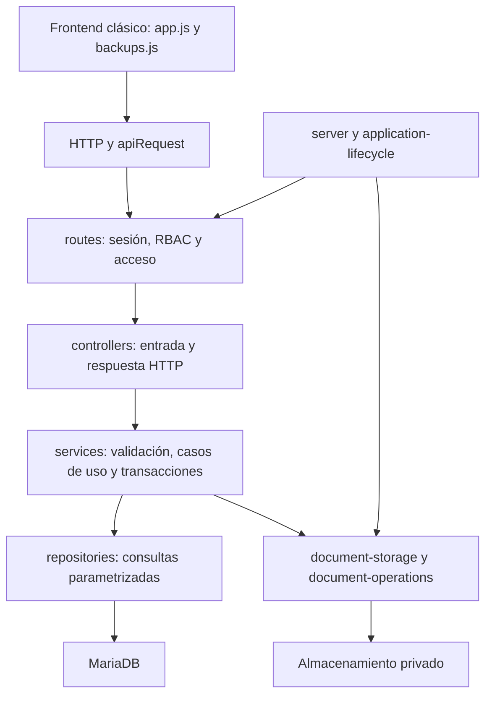
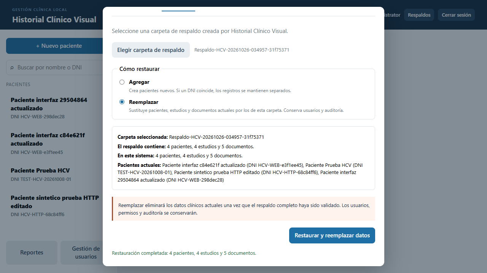

# Revisión general de HCV — 26/10/2026

## Alcance y resultado

Se aplicaron las guías de Brooks Health y Brooks Review a frontend, rutas, controladores, servicios, repositorios, autenticación, recuperación, pruebas y configuración declarada. Después se corrigieron los errores comprobados y se usó webapp-testing con Chrome/Playwright, HTTP y MariaDB reales. No se ejecutó Brooks Sweep.

El diagnóstico incluyó los cambios pendientes de `feature/respaldo-restauracion`. Se conservaron esos cambios, las rutas, los contratos de datos, los IDs del DOM y la arquitectura por capas. No hubo commits, push, instalaciones ni modificaciones del `.env` real o de grants.

La suite final tiene **82 pruebas: 80 aprobadas, 0 fallidas y 2 omitidas**. El recorrido general de Chrome aprobó **15 comprobaciones**. Un caso adicional de cambio de sesión durante una cola de imágenes se reprodujo antes de corregirlo y pasó después.

## Brooks-Lint Health Dashboard

**Mode:** Health Dashboard. **Scope:** diagnóstico inicial del sistema y del trabajo de respaldos pendiente, limitado a los archivos inspeccionados.

| Dimension | Puntaje inicial | Hallazgos considerados |
| --- | ---: | --- |
| Code Quality | 55/100 | Tres Critical: datos de otra sesión, restauración UI bloqueada y respaldo bloqueado por journals completados. |
| Architecture | 100/100 | Capas conservadas; sin ciclos en las dependencias locales analizadas. |
| Tech Debt | 65/100 | Dos Critical: clasificación postcommit y continuación de cola con otra sesión; un Warning: limpieza de cancelación. |
| Test Quality | 90/100 | Dos Warning: comprobaciones textuales de frontend y ausencia de recorridos completos que descubrieran estos casos. |

**Composite Score inicial: 78/100.** Preset balanced, deducciones de 15 por Critical y 5 por Warning; pesos 25%, 30%, 25%, 20%. El conjunto puntuado está limitado por dimensión: no se descuentan dos veces todos los registros de la tabla siguiente. No es una probabilidad de ausencia de errores ni una certificación para producción. El resultado posterior se expresa con pruebas concretas, no con una puntuación proyectada.

Se inspeccionaron las dependencias `require` locales de **43 módulos de `src/`, con 107 enlaces y ningún ciclo detectado**. Este análisis estático no interpreta imports generados dinámicamente ni sustituye la revisión de responsabilidades.

## Registro de fallos y correcciones

Cada fila distingue el síntoma, su causa y consecuencia, la solución aplicada y su evidencia. Las referencias de principios son: **CC**, *Code Complete* (validación y manejo de errores); **DDD**, *Domain-Driven Design* (invariantes de ciclo de vida); **PP**, *The Pragmatic Programmer* (ortogonalidad y recuperación); **Google**, *Software Engineering at Google* (contratos y compatibilidad).

| ID | Symptom → causa y consecuencia | Source | Remedy aplicado y archivos | Verificación |
| --- | --- | --- | --- | --- |
| HCV-01 | El lector solo aceptaba `documentos/nombre`, pero intentaba leer `manifest.json` y `datos-clinicos.json` de la raíz. Toda restauración UI fallaba antes de llamar a la API. | CC | Allowlist exacta para los dos metadatos raíz; se conserva la validación de rutas documentales en `public/js/backups.js`. | Regresión de lectura/traversal y restauraciones reales Agregar/Reemplazar desde Chrome. |
| HCV-02 | Un journal documental `completed` conservaba `backup_key` tras eliminar su copia. El respaldo lo interpretaba como pendiente y respondía 409 indefinidamente. | DDD | Limpieza compartida que elimina archivos antes de vaciar referencias; recuperación de filas históricas; el respaldo distingue operación sin confirmar de limpieza residual confirmada. `document-operations.js`, `document-service.js`, ambos repositorios de operaciones/respaldo. | Reemplazo 200 y eliminación 204 seguidos de exportación 201 con MariaDB real; limpieza histórica comprobada. |
| HCV-03 | `finishDelete()` recibía `backupKey`/`oldKey` del flujo normal, pero solo leía nombres SQL. Podía borrar metadata dejando el `.deleted` hasta el reinicio. | CC | Normalización de ambas formas antes de resolver/eliminar el archivo en `document-operations.js`. | Regresión que exige eliminación física antes del DELETE; comprobación física HTTP/MariaDB. |
| HCV-04 | Un fallo de limpieza postcommit pasaba a `requiere_atencion`; el reintento no admitía ese estado y perdía la evidencia del commit. Podía terminar como `RESTORE_NOT_COMMITTED`. | CC / DDD | `limpieza_pendiente` conserva el resultado confirmado; se acepta la variante histórica inequívoca y se impide entrar a rollback para una operación confirmada. `backup-service.js`. | Regresiones de múltiples fallos y reintento; MariaDB real con fallo transitorio controlado y posterior finalización. |
| HCV-05 | Cancelar marcaba `fallido` antes de limpiar; la recuperación excluía ese estado. Una caída en esa ventana abandonaba archivos y detalles. | PP | Estado recuperable hasta completar limpieza y auditoría; selección de fallidos históricos que todavía tengan detalles. `backup-service.js`, `backup-repository.js`. | Temporales reales y journal MariaDB; limpieza al recuperar y un solo evento de cancelación tras repetir recuperación. |
| HCV-06 | Cinco registros válidos con notas grandes formaban más de 256 KiB y recibían 413. | Google | Lotes por bytes UTF-8, incluido el sobre, además del máximo de cinco registros; mensaje explícito si un registro individual no cabe. `backups.js`. | Regresiones UTF-8 y envío real desde Chrome de cinco pacientes con notas sintéticas grandes sin 413. |
| HCV-07 | Reabrir el diálogo o elegir otra carpeta podía habilitar controles durante una operación y cambiar su origen. | PP | Estado activo para ejecución/pickers; carpetas capturadas localmente; generaciones de sesión invalidan tareas anteriores. `backups.js`. | Pruebas de reentrada y picker/respuesta obsoletos; cierre/reapertura durante creación en Chrome mantuvo controles bloqueados. |
| HCV-08 | Tras restaurar, solo se actualizaba el resumen del diálogo. La ficha/lista principal podía conservar IDs eliminados. | PP | `actualizarVistaClinicaTrasRestauracion(modo)` recarga el listado y descarta ficha/IDs de Reemplazar; preserva selección válida en Agregar. Un error de refresco posterior al commit no se presenta como rollback. `app.js`, `backups.js`. | Ambos modos desde Chrome; conteos reales y ausencia del ID anterior después de Reemplazar. |
| HCV-09 | Logout conservaba fichas y roles en memoria. Una nueva identidad podía recibir contenido anterior; respuestas en vuelo podían volver a publicarlo. | CC | `limpiarDatosClinicos()`, versión de vista, limpieza al cerrar/perder/cambiar sesión y evento interno de reinicio para respaldos. `app.js`, `backups.js`. | Logout real dejó arrays/ficha/roles/metadatos vacíos; respuesta iniciada antes de limpiar fue rechazada como obsoleta. |
| HCV-10 | El validador DOCX miraba solo el primer Override y Relationship. Rechazaba paquetes válidos con propiedades antes del documento principal. | CC | Busca la declaración y relación correctas entre todos los elementos; conserva CRC, tamaños, partes requeridas y bytes originales. `document-storage.js`. | Regresión falló antes del arreglo y pasó después; DOCX sintético con propiedades anteriores se cargó y descargó mediante Chrome/MariaDB. |
| HCV-11 | El UPDATE de intentos incrementaba el contador y luego sumaba otro uno al evaluar el límite. MariaDB bloqueaba al noveno fallo. | CC | Evaluar `blocked_until` antes del incremento en `auth-repository.js`, sin cambiar el límite definido. | SQL real antes: fallo 9 bloqueado. Después: 1–9 sin bloqueo, 10 bloqueado; prueba revertida mediante rollback. |
| HCV-12 | El CLI cambiaba el hash sin invalidar sesiones existentes; una cookie previa seguía siendo válida. | CC | `deleteSessionsForUser()` parametrizado y llamado en la misma transacción que UPDATE y auditoría en `reset-password.js`. Se agregó la plantilla de recuperación que faltaba y su documentación de privilegios. | Helper de revocación ejecutado contra sesiones MariaDB dentro de una transacción y revertido; revisión del orden transaccional del CLI. No se ejecutó el cambio interactivo de contraseña ni se alteraron credenciales. |
| HCV-13 | Una cola de imágenes del formulario podía continuar con la cookie de una sesión nueva después de cerrar y volver a iniciar sesión durante el primer archivo. | PP / CC | Capturar la versión del formulario y detener la cola/continuaciones obsoletas; los botones se reinician con la nueva vista y un finally antiguo no altera la nueva operación. `app.js`. | Chrome con primer upload retenido, logout y login reales: antes intentó 2 uploads; después solo el primero ya iniciado, sin enviar el segundo. |

No se eliminaron validaciones `required`, permisos ni controles de integridad para hacer pasar las pruebas.

## Correcciones de documentación

- `docs/respaldo-restauracion.md` y `README.md`: reemplazan la afirmación obsoleta de que nunca se había probado MariaDB por el alcance real y sus límites; explican reintentos, cancelación, lotes y refresco.
- `sql/README.md`: detalla los privilegios mínimos por tabla nueva y los DELETE sobre `patients`/`studies` que necesita Reemplazar. No se concedieron esos privilegios durante esta tarea.
- `docs/api-rest-hcv.md` y `docs/openapi-hcv.yaml`: documentan el umbral de login, el límite JSON y los errores 413/422 observados en restauración. Se corrigió también la afirmación documental de que el DNI repetido siempre produce conflicto: el índice vigente no es único y el servicio no lo rechaza.
- `.env.password-reset.example`: plantilla sin credenciales, cuyo nombre ya estaba permitido por `.gitignore`; la configuración real no se creó ni modificó.
- No se volvió a editar `docs/Casos de uso HCV.docx`: sus cambios preexistentes se conservaron. Estos arreglos hacen funcionar los recorridos ya descritos; no agregan casos de uso ni cambian los compromisos existentes.

## Pruebas ejecutadas

### Suite versionada

Comando final: `npm test -- --test-reporter=tap`.

- 82 pruebas; **80 PASS, 0 FAIL, 2 SKIP**.
- Omitidas: creación de symlinks no permitida por Windows y prueba MariaDB optativa, desactivada en esa ejecución. La prueba real del motor se realizó aparte.
- Se añadieron 17 regresiones aprobadas respecto de la línea base de 63 aprobadas: frontend de respaldos, recuperación, limpieza documental y DOCX.
- Las pruebas existentes con adaptadores en memoria se conservaron. Solo se agregó al adaptador documental el soporte mínimo de la consulta de limpieza que ahora ejecuta producción.
- Se utilizó un preloader temporal para impedir que `dotenv.config()` leyera el `.env` durante las pruebas. No se cambió la configuración del proyecto.
- `node --check` en los **64 JavaScript** de `src/`, `public/js/` y `test/`: aprobado. `git diff --check`: aprobado; Git solo emitió avisos sobre futuras conversiones LF/CRLF. [Salida TAP final](evidencias/revision-general-2026-10-26.tap).

### HTTP y MariaDB reales

Destino validado antes de escribir: MariaDB **12.2.2**, **127.0.0.1:3317**, base **hcv_test**, datadir **C:/HCV-Test/MariaDB/data**. Se hizo un dump nuevo antes de las pruebas y se aplicó 007 temporalmente solo allí.

Se comprobaron creación/edición y conflicto de versión de pacientes; creación de estudios; recepción de PDF/DICOM; exportación y descarga con SHA-256; Agregar sin fusión por DNI; Reemplazar y limpieza física; preservación de usuarios; rollback tras una FK real; reintentos postcommit; cancelación histórica; reemplazo/eliminación documental sin bloquear exportaciones posteriores; y limpieza de journals completed antiguos. El health de base siguió respondiendo 200 después de los fallos controlados.

La prueba de rollback hizo que el repositorio intentara insertar un estudio con una FK inexistente después de haber insertado pacientes en la transacción. El error real fue `ER_NO_REFERENCED_ROW_2`; la API lo tradujo a 422 y no quedaron pacientes parciales ni cambios en los archivos previos.

Se utilizó una conexión administrativa exclusivamente para el arnés aislado, inyectada en los módulos de la aplicación. Por ello estas pruebas no demuestran que la cuenta normal tenga todos sus grants. La autenticación por cookie y los middlewares RBAC sí fueron los de la aplicación; se probó acceso de administrador y rechazo 401 sin sesión, sin crear usuarios o modificar roles.

### Chrome / Playwright

Se ejecutó el frontend real y el backend HTTP/MariaDB anterior, sin respuestas API simuladas ni puente de red. Las 15 comprobaciones del recorrido general fueron:

1. Credenciales incorrectas y borrado del campo contraseña.
2. Login correcto, `/api/auth/me`, cookie HttpOnly y SameSite Strict.
3. Required de paciente, Cancelar y X sin crear registros.
4. Alta desde formulario.
5. Edición, cancelación y persistencia tras recargar.
6. Required de estudio, cancelación, alta con imagen y vista previa real.
7. Edición de estudio y rechazo HTTP de cambio de fecha.
8. Carga/descarga de PDF, PNG, DICOM y DOCX; comparación de bytes y hash; enlace de descarga del navegador.
9. Reemplazo conservando ID, eliminación y respaldo posterior.
10. Creación de carpeta con manifiesto final, archivos y hashes; controles bloqueados al reabrir mientras trabaja.
11. Restauración Agregar con listado actualizado.
12. Restauración Reemplazar con nueva lista y sin IDs/ficha obsoletos.
13. Lotes UTF-8 grandes por la función real del frontend sin 413.
14. Respuesta obsoleta descartada y logout con limpieza de ficha/roles/referencias y cookie invalidada.
15. Ausencia de errores JavaScript no controlados.

Además se ejecutó el caso HCV-13 antes y después de corregirlo. Un primer intento del recorrido general se detuvo por una aserción temporal del arnés que consultaba el estado disabled antes de que terminara de abrirse el editor asíncrono; se agregó la espera de visibilidad, se conservó el registro y se repitió el recorrido completo. No se cambió la aplicación para ocultar ese fallo de sincronización del test.

El selector de carpetas nativo fue reemplazado por handles de prueba que leyeron/escribieron directorios temporales reales. Esto comprueba la lógica del frontend y los archivos resultantes, pero no el diálogo del Explorador ni sus permisos nativos en una PC cliente LAN.

Resultados estructurados: [evidencias JSON](evidencias/revision-general-2026-10-26.json).

## Estado final y límites

- Se restauró `hcv_test` al estado anterior a toda la tarea. Los dumps deterministas anterior y posterior coincidieron byte por byte: **23.509 bytes**. Quedaron 1 paciente, 1 estudio, 0 documentos y 1 usuario; ninguna tabla ni permiso de 007. No cambiaron cuentas MariaDB ni grants.
- MariaDB se detuvo limpiamente y 3317 quedó cerrado. Los servidores Node y navegadores iniciados por las pruebas se cerraron. La evidencia documental no contiene contraseñas, tokens ni hashes de contraseña.
- **Limpieza temporal pendiente por bloqueo de la herramienta:** la revisión automática rechazó eliminar la carpeta de esta ronda y también los tres dumps nombrados individualmente, indicando únicamente `blocked by policy`. No se intentó eludir el rechazo con otro mecanismo. Permanece `C:/Users/Hered/AppData/Local/Temp/hcv-general-review-20261026-c24a` (45 archivos de esta prueba, sin enlaces, ruta canónica comprobada). Contiene únicamente datos sintéticos, scripts, logs y dumps de `hcv_test`; los dumps sí incluyen los hashes de las cuentas de prueba y deben protegerse hasta que el responsable retire esos temporales. La copia durable y no sensible de resultados está en `docs/evidencias/`. La base original ya estaba restaurada antes de este rechazo.
- La cuenta `hcv_test_app` todavía necesita revisar los privilegios del módulo; no se probó con ella esta ronda. Tampoco se creó un visualizador para una prueba nueva contra MariaDB: sus denegaciones siguen cubiertas por las pruebas HTTP existentes con adaptador en memoria.
- No se mató un proceso durante una escritura ni se desconectó un disco: las recuperaciones se comprobaron sembrando estados durables coherentes y fallos controlados. Hardware, antivirus, ACL de Windows, volumen de datos real, dos procesos Node compartiendo raíz y recuperación ante cortes requieren ensayos específicos.
- Una fila histórica que ya perdió la distinción de commit y solo indica `RECOVERY_FAILED` necesita inspección técnica; no se inventa el resultado. Las nuevas transiciones evitan esa pérdida de información.
- DICOM mantiene bytes y hash con la validación básica existente; no se acredita conformidad completa del formato ni un visor. No se añadieron parsers, PACS, firmas, ZIP o backups automáticos.
- No hay validador YAML/OpenAPI completo disponible en las dependencias del proyecto ni en los runtimes consultados. La especificación se revisó contra el código; queda la validación en Swagger Editor descrita en la documentación. No se instaló ninguna herramienta.
- Las pruebas amplias de navegador/MariaDB de esta ronda se ejecutaron mediante arneses temporales y están documentadas; no se incorporaron como un comando automático de `npm test`. Las regresiones unitarias/HTTP existentes y nuevas sí quedan versionables.

## Archivos de esta ronda

Producción: `public/js/app.js`, `public/js/backups.js`, `src/repositories/auth-repository.js`, `src/cli/reset-password.js`, `src/repositories/document-operation-repository.js`, `src/repositories/backup-repository.js`, `src/services/document-operations.js`, `src/services/document-service.js`, `src/services/document-storage.js`, `src/services/backup-service.js`.

Pruebas: nuevos `test/backup-recovery.test.js` y `test/backups-frontend.test.js`; modificaciones puntuales de `test/document-operations.test.js`, `test/document-http-integration.test.js`, `test/document-storage.test.js` y `test/helpers/docx-fixture.js`.

Documentación/configuración de ejemplo: este registro y sus evidencias, `README.md`, `sql/README.md`, `docs/respaldo-restauracion.md`, `docs/api-rest-hcv.md`, `docs/openapi-hcv.yaml` y `.env.password-reset.example`. Los demás cambios pendientes que ya existían al comenzar se conservaron; esta lista no pretende atribuir toda la rama a esta ronda.

## Comprobación manual posterior

Usar una instalación de prueba con migraciones/grants revisados y almacenamiento temporal: iniciar sesión, crear paciente/estudio, adjuntar un archivo, reemplazarlo/eliminarlo y crear un respaldo. Elegir la misma carpeta para restaurar en Agregar y luego Reemplazar, verificando listas, documentos y confirmaciones. Cerrar sesión con una ficha abierta y comprobar que desaparezcan los datos. No repetir Reemplazar sobre una base existente sin un respaldo aprobado y un plan de recuperación.
